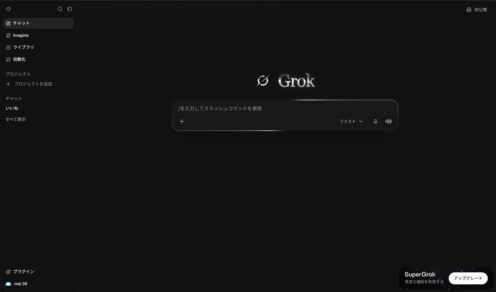

# Grok — Silver Dots Dark

Grokのダークモードを、動くドット背景と銀色の反射でまとめたStylus用テーマです。

## 使い方

1. Stylusをインストールします。
2. [UserCSSをインストール](https://raw.githubusercontent.com/kyotomalmal25-sudo/grok-museum-light/main/grok-silver-dots-dark.user.css)を開き、Stylusの確認画面でインストールします。
3. Grokの表示設定をダークモードにします。
4. 同じ箇所を変更する他のダーク用CSSは無効にしてください。

## 内容

- メイン背景のドットの明暗が26秒周期でゆっくり移動。左メニューのドットは薄く抑えています。
- 淡い青と暖色の反射を含む、銀色のGrokアイコンとセリフ体の文字。
- 墨色 `#181817` の入力欄と、黒に溶けながら14秒周期で回る銀色の枠。
- 音声モードとImagineの送信マークを青みのある銀色に調整。
- 動きを減らすOS設定に対応。
- ダークモードのみ適用。ライト版と併用できます。

Chrome・日本語UIで表示を確認（2026年10月12日）。モバイル・英語UIは未確認です。フォントは端末にあるものを使います。GrokのUI更新によってセレクターの調整が必要になる場合があります。

## English

A dark Stylus theme for Grok with slowly shifting dot highlights, a silver serif wordmark, an ink-colored composer, and rotating silver border highlights that fade into black. Includes matching silver voice-mode and Imagine send icons.

Install the UserCSS, select dark mode in Grok, and disable other styles that modify the same dark-mode elements. The Museum Light theme can remain enabled because each theme is scoped to its corresponding mode.

Checked with Chrome and the Japanese UI on October 12, 2026. Mobile and English UI are unverified. UI changes may require selector updates.

## Author and license

チンパンジー (Chimpanzee). Original CSS and documentation: CC0-1.0. Third-party names, trademarks, and logos remain with their respective owners. This is an unofficial style with no affiliation with xAI.

## Changelog

- **1.0.0 — 2026-10-12:** Initial dark release.