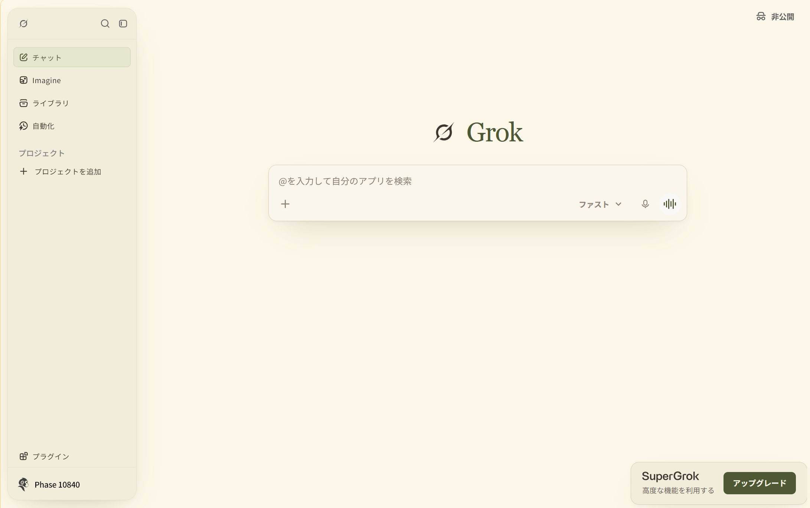

# Grok — Museum Light

Grokのライトモードを、生成りの紙・茶色の文字・オリーブのアクセントでまとめたStylus用テーマです。
[CHIMPANZEE MUSEUM](https://chimpanzee-museum-v2.pages.dev/)の配色と雰囲気を参考にしています。

[UserStyles.worldからインストール](https://userstyles.world/style/30776/grok-museum-light)

## インストール

1. ブラウザーにStylusをインストールします。
2. [UserCSSをインストール](https://raw.githubusercontent.com/kyotomalmal25-sudo/grok-museum-light/main/grok-museum-light.user.css)を開き、Stylusの確認画面でインストールします。
3. [Grok](https://grok.com/)の表示設定をライトモードにします。
4. 同じ箇所を変更する既存のGrok用スタイルは無効にしてください。

## 内容

- メイン背景は `#fcf7e8`。角丸のサイドバー、細いベージュの枠、柔らかな影。
- 茶色のGrokマークと、オリーブ色のセリフ体によるGrokの文字。
- 入力欄、自分の発言の吹き出し、右下の案内カードの配色を統一。
- Imagineの送信ボタンと選択部分をオリーブ系に変更。
- 自動化の上部バー、ライブラリの一覧背景とカテゴリ選択を調整。
- ライトモードのみ適用。ダークモードは変更しません。

2026年10月12日、Chrome・日本語UIで表示を確認。英語UIとモバイルは未確認です。
Grok側のHTML構造やラベルが変わると、一部のスタイルが適用されなくなる場合があります。
文字は端末で利用できるセリフ体を使い、外部フォントをダウンロードしません。

## English

A warm paper and olive light theme for Grok, inspired by Chimpanzee Museum.
Includes a framed sidebar, a serif Grok wordmark, warm composer and user-message surfaces, and matching controls for Imagine, Automations, and Library.

Install the `.user.css` file with Stylus, then select light mode in Grok. Disable other Grok styles that modify the same elements. Dark mode is unchanged.

Checked with Chrome and Grok's Japanese UI on October 12, 2026. English UI and mobile are unverified. Grok UI updates may require selector updates.

## Author and license

チンパンジー (Chimpanzee) / [kyotomalmal25-sudo](https://github.com/kyotomalmal25-sudo)

Original CSS is released under [CC0-1.0](https://creativecommons.org/publicdomain/zero/1.0/).
Grok/xAI names, trademarks, and the Grok logo remain the property of their respective owners. This is an unofficial user style and does not imply affiliation with xAI.

## Changelog

- **1.0.0 — 2026-10-12:** Initial light-mode release, including conversation, Imagine, Automations, and Library adjustments.

## Dark theme / ダーク版

[Grok — Silver Dots Dark](DARK.md): 動くドット背景、銀色ロゴ、墨色の入力欄と回転する銀色の枠。
