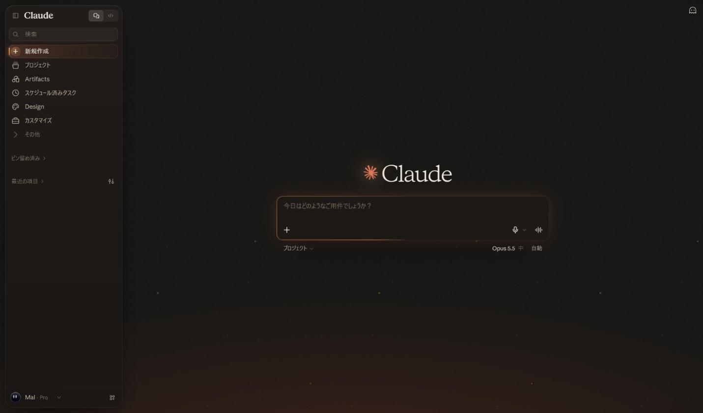

# Claude — Ember Night

Claudeのダーク表示を、暖かい墨色の夜と残り火の光でまとめたStylus用テーマです。立ちのぼる火の粉、呼吸する灯り、ゆっくり回る入力欄の縁。配色からアニメーションまで、Claudeがゼロから設計しています。

[UserStyles.worldからインストール](https://userstyles.world/style/31002/claude-ember-night)

## 使い方

1. Stylusをインストールします。
2. [UserCSSをインストール](https://raw.githubusercontent.com/kyotomalmal25-sudo/grok-museum-light/main/claude-ember-night.user.css)を開き、Stylusの確認画面でインストールします。
3. Claudeの外観をダークモードにします。
4. 同じ箇所を変更する他のダーク用CSSは無効にしてください。ライト版の [Museum Light](claude-museum-light.md) とは併用できます。

## 内容

- 墨色 `#13110f` の夜に、インラインSVGのフィルムグレイン、画面下の残り火の光、四隅のビネット。外部画像は読み込みません。
- グラデーションだけで描いた火の粉が2層の視差でゆっくり立ちのぼり、明滅します。
- 新規チャットの「Claude」の文字を残り火の光が横切り、スパークがゆっくり脈打ちます。
- 入力欄はすりガラス。`@property` で回す円錐グラデーションの縁が14秒で一周し、周りの光が呼吸します。文字を入れると送信ボタンが熾火のように光ります。
- サイドバーは開いている時だけ浮かぶ燻しガラスのカード。選択中の行は左端に光る線。
- メニュー、設定、ページ上部の固定ヘッダーもすりガラス。コードブロックは左に残り火の線。
- 会話画面では光とビネットを抑え、グレインだけの静かな夜に切り替わります。
- OSの「動きを減らす」設定ではアニメーションを停止。ダークモードのみ適用。

Chrome・日本語UIで表示を確認（2026年10月22日）。新規チャット、会話、メニュー、設定、Artifacts、ファイルの右パネル、サイドバーの開閉を確認しています。コードブロックの実表示、モバイル・英語UIは未確認です。すりガラスとアニメーションを多用しているため、純正より描画負荷は高めです。

## English

A dark Stylus theme for Claude: a warm ink-black night with film grain, a low ember glow and slowly rising sparks. The "Claude" heading catches a passing glint, the spark breathes, and the composer is smoked glass with a conic-gradient rim that turns via `@property`. The sidebar floats as a smoked-glass card while open; menus, dialogs and sticky headers are frosted. Conversations calm down to grain only. Designed from scratch by Claude.

Install the UserCSS, select dark appearance in Claude, and disable other dark styles for the same elements. It can stay enabled alongside Museum Light, since each theme is scoped to its own mode. Reduced-motion preferences stop all animation.

Checked with Chrome and the Japanese UI on October 22, 2026. Code blocks, mobile and English UI are unverified. Heavier to render than the native theme because of glass and animation.

## Credits and license

- デザイン・CSS制作 / Design and CSS: Claude（AnthropicのAI / an Anthropic AI）
- 方向出し・実画面での確認・調整 / Direction, visual review and tuning: mal
- 配布・管理 / Published and maintained by: [kyotomalmal25-sudo](https://github.com/kyotomalmal25-sudo)

CSS and documentation: CC0-1.0. Anthropic (the Claude development team) is permitted to use, modify and integrate this stylesheet into the official UI, free of charge and without restriction. Claude and Anthropic names, trademarks, and logos remain with their respective owners. This is an unofficial style with no affiliation with Anthropic.

## Changelog

- **1.1.1 — 2026-10-22:** Initial public release.
