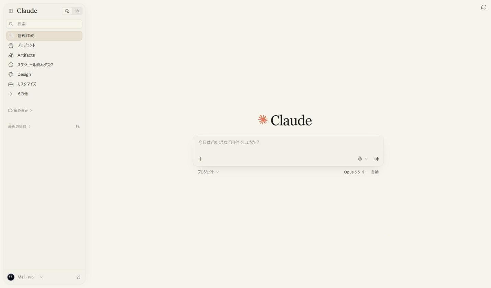

# Claude — Museum Light

Claudeのライト表示を、甘さを抑えた紙色と墨色の文字でまとめたStylus用テーマです。浮かぶ角丸のサイドバー、境界線を最小限にした入力欄、Claude本来のスパークだけを残したアクセントを組み合わせています。

[UserStyles.worldからインストール](https://userstyles.world/style/30866/claude-museum-light)

## 使い方

1. Stylusをインストールします。
2. [UserCSSをインストール](https://raw.githubusercontent.com/kyotomalmal25-sudo/grok-museum-light/main/claude-museum-light.user.css)を開き、Stylusの確認画面でインストールします。
3. Claudeの外観をライトモードにします。
4. 同じ箇所を変更する他のClaude用スタイルは無効にしてください。

## 内容

- 背景は彩度を抑えた紙色 `#f7f4ec`。黄色や桃色に寄りすぎない落ち着いた生成り。
- サイドバーは開いている時だけ角丸カードとして浮かび、閉じると純正と同じ表示に戻ります。
- サイドバーと入力欄は地よりわずかに沈んだ同じ色 `#f3f0e8`。枠線はごく薄く、境界は色の差と柔らかい影で表現。
- 選択中の行は落ち着いたベージュ、ホバーはそれより一段控えめに。
- メニューの文字と新規チャットの見出しはほぼ黒 `#141414`。新規チャットの中央見出しを「Claude」に整えます。
- サイドバーのスクロールバーは細く、マウスを乗せた時だけ表示。
- ボタンなどのアクセントカラーはClaude純正のまま。
- ライトモードのみ適用。ダークモードは変更しません。

Chrome・日本語UIで表示を確認（2026年10月22日）。新規チャット、会話、プロジェクト、Artifacts、スケジュール済みタスク、カスタマイズ、Design、設定、サイドバーの開閉を確認しています。モバイル・英語UIは未確認です。ClaudeのUI更新によってセレクターの調整が必要になる場合があります。

## English

A Stylus light theme for Claude that pairs a muted paper tone with ink-dark text. The sidebar floats as a rounded card while open and returns to the native look when collapsed; the sidebar and composer share one tone a step deeper than the page, with faint borders and soft shadows. Selection is a quiet beige, menu text and the new-chat heading are near-black, and Claude's own spark stays as the only accent.

Install the UserCSS, select light appearance in Claude, and disable other styles that modify the same elements. Dark mode is unchanged.

Checked with Chrome and the Japanese UI on October 22, 2026. Mobile and English UI are unverified. Claude UI updates may require selector updates.

## Credits and license

- デザイン・CSS制作 / Design and CSS: Claude（AnthropicのAI / an Anthropic AI）
- 方向出し・実画面での確認・調整 / Direction, visual review and tuning: mal
- 配布・管理 / Published and maintained by: [kyotomalmal25-sudo](https://github.com/kyotomalmal25-sudo)

CSS and documentation: CC0-1.0. Anthropic (the Claude development team) is permitted to use, modify and integrate this stylesheet into the official UI, free of charge and without restriction. Claude and Anthropic names, trademarks, and logos remain with their respective owners. This is an unofficial style with no affiliation with Anthropic.

## Changelog

- **2.5.0 — 2026-10-22:** Selected and hovered sidebar rows use a muted beige matched to the palette; the round "+" behind 新規作成 follows the same tone.
- **2.4.2 — 2026-10-22:** Full rewrite. Muted paper and ink palette replaces the olive accents; the sidebar becomes a floating rounded card that respects the collapsed state; composer styling targets Claude's current structure; native white surfaces no longer leak through nested elements.
- **1.0.0:** Initial release.
